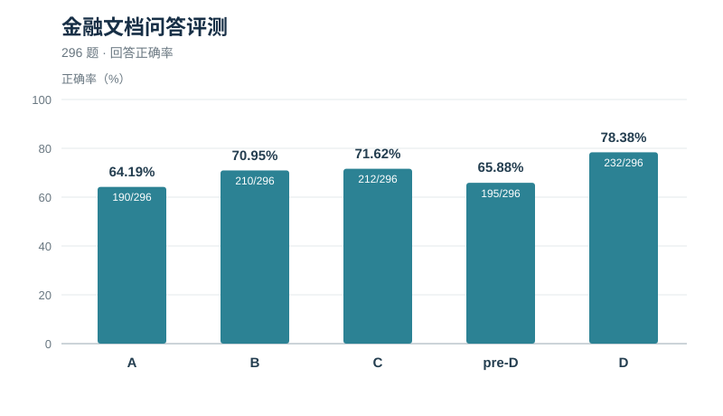

# 金融文档 RAG

[返回示例目录](../README.md) · [主线教程](../../README.md#主线教程目录)

这是主线前六章的配套项目，以六份真实金融财报及其问答题为材料，展示从长篇 PDF 到可追溯原文的 RAG 问答流程。项目提取 PDF 文本，并使用 Docling 解析标题、正文、表格和图片，保留内容与原始页面的关联；解析结果还可以进一步清洗和审阅，对局部难页使用 MinerU 辅助诊断。

项目分别按平面文本和文档结构切片，也可以为正文与图表生成摘要，再通过关键词和向量混合检索定位相关内容。查询时，系统按需回读上下文、表格、图注和原始页面，将回答关联到读取过的来源；读者可以对比 Native RAG 和 Agentic RAG 两种方式。项目还使用从上游数据中筛选出的 296 道问题进行评测，记录评分，帮助读者观察不同文档表示、检索入口和阅读方式的效果。

## 项目如何工作

下图按文档、文档表示、检索与阅读、评测四个阶段展示项目流程：


平面路线提供基线，结构化路线保留标题、节点关系和来源位置，并可在切片前进行清洗与审阅。各方案通过关键词和向量混合检索查找内容；摘要只提供补充入口，命中后仍回读原文。五组方案的区别如下：

| 方案 | 检索与阅读方式 |
| --- | --- |
| A | 检索平面原文切片 |
| B | 检索结构化原文，结合文档关系扩展上下文 |
| C | 在 B 的原文入口上补充摘要召回，再回读原文 |
| pre-D | 使用 D 自动扩展前的首次检索与阅读快照直接回答 |
| D | 在首次快照基础上自动扩展原文，再由模型按需继续检索和回读 |

下面按数据流介绍各环节，以及实现中为了处理真实财报所做的取舍。

## 项目目录结构

下面从示例项目根目录展开主要目录和代码模块；同类文件用通配符合并，`__init__.py` 等包标记文件不逐一列出。

```text
financial-document-rag/
├── README.md、AGENTS.md             项目说明和开发约定
├── pyproject.toml、uv.lock          Python 依赖声明和锁文件
├── .python-version、.gitignore      Python 版本和 Git 忽略规则
├── config.toml                      默认运行配置
├── config.offline.toml              本地检查配置
├── .env.example                     环境变量示例
├── assets/                          README 流程图和评测图
├── profiles/cleaning-v2/            六份财报各自的清洗配置（使用清洗技能优化文档）
├── src/financial_rag/
│   ├── cli.py、commands/            命令行入口及命令适配
│   ├── dataset.py                   下载数据、筛选题集和准备标注
│   ├── document/                    文档解析和事实层
│   │   ├── parsing*.py、models.py   PDF 解析、解析保护与模型权重
│   │   ├── facts.py、provenance.py  事实节点与来源关系
│   │   ├── imported.py              读取已审阅的文档交付
│   │   └── table_serialization.py   表格检索文本序列化
│   ├── indexing/                    检索资料准备
│   │   ├── chunking.py              平面、结构化与增强切片
│   │   └── enrichment.py、summary_windows.py  正文和图表摘要
│   ├── query/                       检索、回读和回答
│   │   ├── retrieval.py             向量化、混合检索与排名
│   │   ├── readback.py、sources.py  节点回查、证据与引用检查
│   │   ├── bc_restoration.py、structural_expansion.py  原文和上下文扩展
│   │   ├── agent_reading.py、context_capacity.py     Agent 阅读与上下文控制
│   │   ├── evidence_packet.py       首次阅读快照
│   │   ├── runner.py                方案调度、续跑和记录
│   │   └── experiments/             A、B、C、pre-D、D 及共享回答逻辑
│   ├── diagnostics/                 数据质量与回读审计
│   ├── storage.py                   SQLite 存储与数据访问
│   ├── api.py、budget.py            模型服务调用与可选预算
│   ├── config.py、tokenization.py   配置校验与 token 估算
│   ├── common.py、validation.py、release_security.py  通用及发布辅助逻辑
│   └── evaluation.py                指标计算、评分和报告
└── tests/                           离线测试、测试辅助与 Docling 集成测试
```

运行后还会在本地生成 `.venv/`、`.env`、`.local/` 和 `model_weights/`，分别用于虚拟环境、密钥配置、工作区及运行结果、模型权重；这些本地文件和目录不随 Git 提交。

文档清洗由仓库根目录的独立 [clean-financial-documents Skill](../../.agents/skills/clean-financial-documents/SKILL.md) 负责，它自带脚本和依赖，不依赖本示例的 Python 包或 SQLite 工作区。

## 数据集来源

项目使用 [ViDoRe V3 Finance - EN](https://huggingface.co/datasets/vidore/vidore_v3_finance_en) 数据集，其中包含六份美国金融机构 2024 财年的年度报告、英文问题、参考答案和相关页面标注。原始 PDF 可以在上游的 [pdfs 目录](https://huggingface.co/datasets/vidore/vidore_v3_finance_en/tree/main/pdfs)查看和下载。为保持数据一致，示例下载时使用上游的 [7f432c1 版本](https://huggingface.co/datasets/vidore/vidore_v3_finance_en/tree/7f432c176d82e27546501ad8064a713ac3071809)。

为了减少题目本身的质量对评测的影响，我从原始英文题集中筛除了 13 道题（答案不可靠），它们在上游数据中的 `query_id` 分别为：`0`、`1`、`54`、`56`、`80`、`81`、`82`、`90`、`133`、`166`、`180`、`192`、`257`。剩余的 296 道题保留原题、参考答案和相关性标注，作为本项目统一的评测集。

数据下载、题目筛选和标注准备见 [dataset.py](src/financial_rag/dataset.py)。

## 文档解析与清洗

对应教程：[001 · 文档格式与事实层](../../tutorials/main/001-document-format.md)讨论为什么保留文档结构和来源；[002 · DoclingDocument](../../tutorials/main/002-docling-document.md)介绍统一的文档对象与节点关系；[003 · OCR 与文档解析](../../tutorials/main/003-ocr-and-parsing.md)讨论如何根据输入选择解析方式，并对照原页检查结果。

解析与事实层代码位于 [document/](src/financial_rag/document/)，其中 [parsing.py](src/financial_rag/document/parsing.py) 负责初始解析，[imported.py](src/financial_rag/document/imported.py) 负责读取已审阅的文档交付。清洗和标题审阅由独立 Skill 完成。

### 先保留原文和结构

平面路线使用 PyMuPDF 提取每页文本，再按长度切片；它适合做基线，但章节关系、表格结构和图片内容很难仅靠文字还原。结构化路线使用 Docling 解析 PDF，保留解析器给出的标题、正文、表格、图片、图注、页码和区域位置，并将节点及其父子关系写入 SQLite；项目不再自动重建标题树。后续切片和回读都引用这些节点，遇到问题时可以回到原始 PDF 检查。

这批财报主要有可用的文字层，默认使用 CPU、关闭 OCR 并启用较精细的表格识别；扫描件或文字层受损的页面可能需要 OCR。解析质量还取决于版面：多栏阅读顺序、跨页正文、合并表头和图片区域都可能出错，因此这里保留原始解析快照，并可使用独立 Skill 诊断、清洗和审阅。

### 用 MinerU 处理局部难页

Docling 的解析并非在每种版面上都理想。遇到漏表、表格错列或正文顺序混乱时，可由独立清洗 Skill 诊断和比较本地候选；必要时使用 MinerU 对具体页面生成另一份结构化候选，再对照原页判断是否采纳。候选需保留原始文档和物理页映射，标题层级仍需结合目录和原文审阅。

MinerU 是可选云端服务，可能上传所选 PDF 页面并产生费用；具体授权、来源与审阅要求见 [Skill](../../.agents/skills/clean-financial-documents/SKILL.md)。默认运行流程只使用本地 Docling。

## 切片与检索入口

对应教程：[004 · Chunk 与增强层](../../tutorials/main/004-chunks-and-enrichment.md)介绍结构化切片、表格与图片的检索入口，以及摘要和原文之间的关系。

切片和摘要的主要实现分别位于 [chunking.py](src/financial_rag/indexing/chunking.py) 与 [enrichment.py](src/financial_rag/indexing/enrichment.py)；向量化和检索入口见 [retrieval.py](src/financial_rag/query/retrieval.py)。

平面切片按 token 长度和重叠量切分页文本。结构化切片使用 Docling 的 `HybridChunker`，结合事实层的标题路径与节点关系，尽量在同一章节内组织内容；表格使用多行表头序列化，较长表格拆分时重复必要表头。切片同时保存指向原始节点和页面的关系；片段可以唯一定位到原文时进一步细化来源，不能精确定位时保留较粗的来源范围。

财报中有些表格过长，有些图表则不包含可直接检索的文字。`enrich` 可以为连续正文、表格和图片生成摘要：正文按同一章节的连续切片组成窗口；长表格分段概括后再合并；图片及未提取出单元格的表格区域使用视觉模型查看原图。生成内容只作为补充入口，精确数字和引用仍来自回读的原文或原始页面。摘要、向量和评分结果可以缓存，已完成的问答记录也可以在续跑时复用；更改模型或解析结果后，受影响的内容需要重新生成。

正文摘要使用文本模型的非思考模式，单次输出上限为 1024 token，以控制批量摘要的开销；实现会向服务发送 `thinking` 和 `reasoning_effort` 参数。如果所用网关不支持这些参数，需要调整 [summary_windows.py](src/financial_rag/indexing/summary_windows.py) 中的摘要请求配置。

## 混合检索、回读与回答

对应教程：[005 · 从召回到回答](../../tutorials/main/005-retrieval-and-agentic-rag.md)介绍混合检索、原文回读和 Agentic RAG；[006 · 数据库存储与结构化回查](../../tutorials/main/006-databases-and-source-lookup.md)介绍如何保存节点关系，并从命中的切片定位和扩展原文。

检索见 [retrieval.py](src/financial_rag/query/retrieval.py)，原文节点回查见 [readback.py](src/financial_rag/query/readback.py)，五组方案位于 [experiments/](src/financial_rag/query/experiments/)；[runner.py](src/financial_rag/query/runner.py) 调度方案并保存运行记录，[sources.py](src/financial_rag/query/sources.py) 管理原文证据和引用检查，SQLite 存储由 [storage.py](src/financial_rag/storage.py) 管理。

示例用 SQLite FTS5 做关键词检索，用 `sqlite-vec` 做向量检索，再以 RRF 合并两路排名。关键词检索适合财报中的公司名、年份和术语，向量检索有助于匹配不同表述；两路的候选数、融合参数和最终返回数都可以在 [config.toml](config.toml) 中调整。切片及其来源、向量、运行记录放在同一个本地工作区，便于查看完整链路。

B 先按排名读取命中的结构化原文及其关联图注、脚注，再读取同章节的邻近节点；重复覆盖的原文不会反复占用候选位置。C 保留 B 的原文入口，再补充指向其他原文的摘要命中。表格或图片可以关联原始页面图像，便于模型结合文字阅读；启用图片回读时，回答模型也需要支持图片输入。文本与图片都有可配置的上限，避免一次性把整份财报塞进上下文。

固定流程不会根据正文中的 “Table 9” 等文字自动跳转，也不会自动扩展相邻章节或追加整页文本；这些情况可以由 D 继续搜索和指定页面回读。B/C 命中表格或图片时仍可读取其来源页面的图像。

此前 B/C 使用多阶段原文扩展：除了命中内容和局部上下文，还尝试解析正文中指向表格、图表等内容的引用，读取父章节概览、跨标题的相邻内容，并在表格、跨页续文或结构缺口处补读原页文字。当前版本将固定流程简化为先读命中原文及关联图注、脚注，再读取同章节的有限上下文；需要更远范围的搜索或阅读时交给 D。已有结果中的 B/C 成绩采用的是简化前流程。

D 使用结构化原文索引：先将问题整理成检索查询和待回答项，保存首次检索与阅读快照；随后程序自动扩展原文，再由 Agent 视情况继续搜索、回读上下文或查看原页。pre-D 直接使用同一份自动扩展前的快照回答。因此 pre-D 与 D 的差异同时包含自动扩展和后续探索，不能只归因于 Agent 的自主探索。程序保留读取过的证据、工具调用和引用关系；上下文空间不足时，较早的内容会被压缩成可再次读取的来源提示。上下文和图片 token 数采用估算，实际限制仍以模型服务为准。

## 评测什么

本示例在[005 · 查询流程](../../tutorials/main/005-retrieval-and-agentic-rag.md)讨论的检索、回读和引用检查基础上，进一步用以下指标评测结果。

指标计算、模型评分和报告生成见 [evaluation.py](src/financial_rag/evaluation.py)。

评测同时看检索和回答：NDCG@10、Recall@5、Recall@10 使用上游相关页面标注衡量初始检索，原页覆盖率统计实际读取的证据覆盖了哪些标注页；引用有效性检查引用是否指向已读取的证据。回答正确率由评分模型对照参考答案判断，逐题结果和理由都会保存。引用有效并不自动代表回答正确，模型评分也可能出错，因此有必要抽查原文和逐题记录。

## 环境与配置

项目使用 `uv` 管理 Python 3.11 环境和依赖；依赖声明与锁文件分别位于 [pyproject.toml](pyproject.toml) 和 [uv.lock](uv.lock)，本地虚拟环境默认放在 `.venv/`。以下命令在 `examples/financial-document-rag/` 目录下执行：

```powershell
uv sync --locked --extra ocr
uv run --locked --offline --no-sync finance-rag --help
```

首次安装需要下载依赖；Docling 解析需要模型权重和计算资源，默认使用 CPU。`--extra ocr` 安装可选 OCR 依赖；默认财报解析配置关闭 OCR。首次使用 `tiktoken` 时也需要取得其编码文件。

将 [.env.example](.env.example) 复制为本机 `.env`（已有文件可直接编辑），填写 `FINANCIAL_RAG_BASE_URL`、`NEW_API_KEY` 和 `DASHSCOPE_API_KEY`。网关地址包含 API 前缀，例如 `https://your-gateway.example/v1`。默认配置使用该网关进行回答、图像描述和评分，使用 DashScope 进行向量化；请在 [config.toml](config.toml) 中按实际服务提供的模型 ID、地址和参数调整。下载数据和本地解析不需要模型服务密钥。

运行 D 方案前，按实际模型设置 `query.context_window_tokens` 和回答模型的 `max_tokens`。程序使用配置的 tokenizer 估算文本和图片请求大小，并为输出预留空间；这个估算不等于服务商的实际计费或精确 token 数。向量化、摘要、回答和评分会调用模型服务，可能产生费用。

配置校验、token 估算和模型服务调用分别由 [config.py](src/financial_rag/config.py)、[tokenization.py](src/financial_rag/tokenization.py) 和 [api.py](src/financial_rag/api.py) 实现；可选预算逻辑位于 [budget.py](src/financial_rag/budget.py)。

阅读和检索的主要参数位于 `query` 与 `retrieval` 配置段：

| 参数 | 默认值与范围 | 作用 |
| --- | --- | --- |
| `sparse_k`、`dense_k`、`rrf_k`、`final_k` | `50`、`50`、`20`、`20`，均至少为 1 | 两路候选数、RRF 参数和最终入口数 |
| `summary_supplement_k` | `5`，范围 0–20 | C 在原文之外最多补充多少个摘要入口 |
| `bc_text_tokens` | `25000`，至少为 1 | B/C 的阅读文本上限，同时受 `text_tokens` 约束 |
| `page_images` | `8`，至少为 0 | 固定查询流程可读取的页面图像数 |
| `exploration_calls` | `24`，范围 1–100 | D 的探索阶段模型调用数，包含首次问题整理；结束时还会留一次最终回答机会 |
| `agent_total_images`、`agent_request_images` | `16`、`8`，范围均为 0–100 | D 总共可读取的页面图像数，以及单次请求中最多携带的图像数 |

如需限制模型服务的调用次数，可以在配置中增加一套可选预算：

```toml
[budget]
ledger = ".local/model-budget.sqlite"
batch = "example-1"
request_limit = 1000
token_limit = 1000000
unknown_usage_limit = 10
```

预算默认关闭；启用时必须设置 `ledger` 和 `request_limit`。同一个账本和批次统计向量化、文本、视觉和评分的所有 HTTP 尝试，包括重试；相同批次不能中途更改限额。`token_limit` 可省略，它依据服务商返回的用量在请求结束后累计，因此单次或并发请求可能越过该值；没有用量的请求会计入未知用量。MinerU 使用独立的服务，不计入这套模型调用预算。`doctor` 可以查看当前预算状态。

## 运行示例

以下步骤先以未经清洗的解析结果运行一题，再展示可选清洗和完整方案比较。也可以在结构化解析后、首次切片前完成清洗与接入，然后从接入后的切片步骤继续。

| 阶段 | 输入与主要命令 | 输出 | 是否必需及模型服务 |
| --- | --- | --- | --- |
| 数据与权重 | `download`、`download-models` | 财报、题集、标注和 Docling 权重 | 必需；需要下载，不调用问答模型服务 |
| 解析与可选清洗 | `parse`；独立 Skill 可选清洗、审阅后用 `parse --documents` 导入 | 平面或结构化事实，及可选的审阅事实层 | 解析必需；清洗可选，本地默认流程不调用模型服务；MinerU 云端诊断另计 |
| 切片与索引 | `chunk`、`embed`；C 还需要 `enrich` | 检索切片、向量，以及 C 所需摘要 | 所选方案的索引必需；向量化和摘要调用模型服务 |
| 回答与评测 | `run`、`evaluate`、`report` | 回答、来源、逐题评分和汇总报告 | 回答调用模型服务；评分调用 judge 模型 |

### 1. 准备数据和模型

```powershell
uv run --locked --no-sync finance-rag download
uv run --locked --no-sync finance-rag download-models
```

`download` 下载固定版本的数据，并按上述清单生成 296 题及原始标注；`download-models` 将 Docling 权重下载到 `model_weights/docling/`。这两步需要访问上游，但不调用问答模型服务。

### 2. 解析、建索引并运行一题

下面使用 B 方案检索结构化原文，运行题集中的第一题：

```powershell
uv run --locked --no-sync finance-rag parse --parser structured
uv run --locked --no-sync finance-rag chunk --index structured
uv run --locked --no-sync finance-rag embed --index structured
uv run --locked --no-sync finance-rag run --run demo --arms B --limit 1
uv run --locked --no-sync finance-rag evaluate --run demo
uv run --locked --no-sync finance-rag report --run demo
```

结果写入 `.local/workspace/runs/demo/`：`results.jsonl` 包含回答及来源，`scored.jsonl` 包含逐题评分，`summary.csv` 和 `report.md` 汇总评测结果。评分需要配置 judge 模型。可以用 `--query-id <题目ID>` 指定题目，多次传入以选择多题；`--limit` 选择题集前 N 题。

保留相同参数并重复使用运行编号会沿用已完成记录；需要重试失败题目时添加 `--retry-errors`。每个方案的每道题在同一运行编号下最多尝试 4 次（含首次），达到上限后会跳过；如需再次尝试，先排查失败原因，再用新的运行编号重新运行所选题目。更换题目、方案或配置时也要使用新的运行编号。

### 3. 可选：使用清洗并审阅后的文档

如果需要修正标题结构、目录页或局部表格，让 Agent 按仓库根目录的 [clean-financial-documents Skill](../../.agents/skills/clean-financial-documents/SKILL.md) 在独立工作目录处理 PDF。Skill 输出普通 DoclingDocument 文件、来源和实际审阅记录；它不需要本项目的 SQLite 工作区。[profiles/cleaning-v2/](profiles/cleaning-v2/) 保存这六份财报的既有清洗决策，只适用于各自的文档和解析版本；使用前要核对页面与节点引用，不能套用到新文档。

完成清洗及最终标题树审阅后，按 Skill 的[交付契约](../../.agents/skills/clean-financial-documents/references/document-delivery.md)生成 `manifest.json`，每份文档包含 `doc_id`、`pdf`、`document` 和 `review`；路径以清单所在目录为基准。清单必须覆盖题集的全部文档，PDF 必须与题集原文一致。以下示例假设交付清单位于 `.local/reviewed/manifest.json`：

```powershell
uv run --locked --no-sync finance-rag parse --parser structured --documents .local/reviewed/manifest.json
uv run --locked --no-sync finance-rag chunk --index structured
uv run --locked --no-sync finance-rag embed --index structured
```

导入会检查文件、文档标识、原文 PDF、物理页映射、DoclingDocument 结构和审阅记录，并将相对路径引用的图片嵌入工作区快照，避免交付目录移动后失效；不会修改原 PDF、题目、标注或已有运行记录。结构化事实改变后需重建相关索引；若已构建增强索引，还要重新运行 `enrich` 和 `chunk --index enriched`。使用新的运行编号评测新的事实层。旧版 SQLite 清洗发布包不能直接接入；可由 Skill 的通用只读提取工具按实际数据库结构取出快照和审阅材料，经核对后整理为文件交付。
### 4. 比较五组方案

在结构化索引准备完成后，再构建平面索引和增强索引：

```powershell
uv run --locked --no-sync finance-rag parse --parser flat
uv run --locked --no-sync finance-rag chunk --index flat
uv run --locked --no-sync finance-rag enrich
uv run --locked --no-sync finance-rag chunk --index enriched
uv run --locked --no-sync finance-rag embed --index all
uv run --locked --no-sync finance-rag run --run comparison --arms A B C D pre-D --limit 1
uv run --locked --no-sync finance-rag evaluate --run comparison
uv run --locked --no-sync finance-rag report --run comparison
```

`enrich` 会为正文及图表生成摘要，需要文本和视觉模型。这里先用一题检查流程；去掉 `--limit 1` 后会运行完整的 296 题。pre-D 使用同一次 D 运行的首次阅读快照，因此需要与 D 一起运行。

处理自己的文档还需要准备文档清单、原始解析和对应的清洗决策；当前 `download` 入口针对本数据集。

## 本地检查

```powershell
uv run --locked --offline --no-sync finance-rag --config config.offline.toml doctor
uv run --locked --offline --no-sync python -B -m pytest -m "not docling" -q -p no:cacheprovider
```

`doctor` 使用 [config.offline.toml](config.offline.toml) 检查本地配置、SQLite 和已准备的数据及索引，不调用模型服务，并在对应工作目录生成 `doctor.json`。[tests/](tests/) 包含离线测试和集成测试；真实 PDF 与本地 Docling 权重的集成测试使用 `docling` 标记，需要另外提供测试材料。

项目数据与来源审计入口可通过 `finance-rag diagnose --help` 查看；文档解析诊断和可选的 MinerU 处理见独立清洗 Skill。

原始财报、模型权重、索引、运行结果和真实密钥保存在本地，不随 Git 提交。

## 实验方案与结果

五组方案的检索与阅读方式见[项目如何工作](#项目如何工作)；检索参数见[环境与配置](#环境与配置)。



按评测模型的判断，B 答对 210 题，比平面基线 A 多 20 题（正确率提高 6.76 个百分点），说明这组实验中结构化原文检索与上下文阅读的组合表现更好。C 在 B 的基础上增加摘要入口后答对 212 题，多 2 题（按题数计算约 0.68 个百分点），整体提升较小，值得结合逐题检索和回读记录观察摘要在哪些问题上带来帮助。D 答对 232 题，比共享首次阅读快照的 pre-D 多 37 题（12.50 个百分点）；两者之间同时包含自动原文扩展和后续 Agent 阅读的影响。
