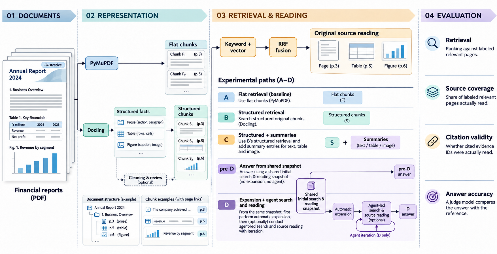

# 金融文档 RAG

[返回示例目录](../README.md) · [主线教程](../../README.md#主线教程目录)

这是主线前六章的配套项目，以六份真实金融财报及其问答题为材料，展示从长篇 PDF 到可追溯原文的 RAG 问答流程。项目提取 PDF 文本，并使用 Docling 解析标题、正文、表格和图片，保留内容与原始页面的关联；解析结果还可以进一步清洗和审阅，对局部难页使用 MinerU 辅助诊断。

项目分别按平面文本和文档结构切片，也可以为正文与图表生成摘要，再通过关键词和向量混合检索定位相关内容。查询时，系统按需回读上下文、表格、图注和原始页面，将回答关联到读取过的来源；读者可以对比 Native RAG 和 Agentic RAG 两种方式。项目还使用从上游数据中筛选出的 296 道问题进行评测，记录评分，帮助读者观察不同文档表示、检索入口和阅读方式的效果。

## 项目如何工作

下图按文档、文档表示、检索与阅读、评测四个阶段展示项目流程：



平面路线提供基线，结构化路线保留标题、节点关系和来源位置，并可在切片前进行清洗与审阅。各方案通过关键词和向量混合检索查找内容；摘要只提供补充入口，命中后仍回读原文。五组方案的区别如下：

| 方案 | 检索与阅读方式 |
| --- | --- |
| A | 检索平面原文切片 |
| B | 检索结构化原文，结合文档关系扩展上下文 |
| C | 在 B 的原文入口上补充摘要召回，再回读原文 |
| pre-D | 使用 D 自动扩展前的首次检索与阅读快照直接回答 |
| D | 在首次快照基础上自动扩展原文，再由模型按需继续检索和回读 |

下面按数据流介绍各环节，以及实现中为了处理真实财报所做的取舍。

## 项目目录结构

下面从示例项目根目录展开主要目录和代码模块；同类文件用通配符合并，`__init__.py` 等包标记文件不逐一列出。

```text
financial-document-rag/
├── README.md、AGENTS.md             项目说明和开发约定
├── pyproject.toml、uv.lock          Python 依赖声明和锁文件
├── .python-version、.gitignore      Python 版本和 Git 忽略规则
├── config.toml                      默认运行配置
├── config.offline.toml              本地检查配置
├── .env.example                     环境变量示例
├── assets/                          README 流程图和评测图
├── profiles/cleaning-v2/            六份财报各自的清洗配置（使用清洗技能优化文档）
├── src/financial_rag/
│   ├── cli.py、commands/            命令行入口及命令适配
│   ├── dataset.py                   下载数据、筛选题集和准备标注
│   ├── document/                    文档解析和事实层
│   │   ├── parsing*.py、models.py   PDF 解析、解析保护与模型权重
│   │   ├── facts.py、provenance.py  事实节点与来源关系
│   │   ├── imported.py              读取已审阅的文档交付
│   │   └── table_serialization.py   表格检索文本序列化
│   ├── indexing/                    检索资料准备
│   │   ├── chunking.py              平面、结构化与增强切片
│   │   └── enrichment.py、summary_windows.py  正文和图表摘要
│   ├── query/                       检索、回读和回答
│   │   ├── retrieval.py             向量化、混合检索与排名
│   │   ├── readback.py、sources.py  节点回查、证据与引用检查
│   │   ├── bc_restoration.py、structural_expansion.py  原文和上下文扩展
│   │   ├── agent_reading.py、context_capacity.py     Agent 阅读与上下文控制
│   │   ├── evidence_packet.py       首次阅读快照
│   │   ├── runner.py                方案调度、续跑和记录
│   │   └── experiments/             A、B、C、pre-D、D 及共享回答逻辑
│   ├── diagnostics/                 数据质量与回读审计
│   ├── storage.py                   SQLite 存储与数据访问
│   ├── api.py、budget.py            模型服务调用与可选预算
│   ├── config.py、tokenization.py   配置校验与 token 估算
│   ├── common.py、validation.py、release_security.py  通用及发布辅助逻辑
│   └── evaluation.py                指标计算、评分和报告
└── tests/                           离线测试、测试辅助与 Docling 集成测试
```

运行后还会在本地生成 `.venv/`、`.env`、`.local/` 和 `model_weights/`，分别用于虚拟环境、密钥配置、工作区及运行结果、模型权重；这些本地文件和目录不随 Git 提交。

文档清洗和审阅由仓库根目录的独立 [clean-financial-documents Skill](../../.agents/skills/clean-financial-documents/SKILL.md) 负责。

## 数据集来源

项目使用 [ViDoRe V3 Finance - EN](https://huggingface.co/datasets/vidore/vidore_v3_finance_en) 数据集，其中包含六份美国金融机构 2024 财年的年度报告、英文问题、参考答案和相关页面标注。原始 PDF 可以在上游的 [pdfs 目录](https://huggingface.co/datasets/vidore/vidore_v3_finance_en/tree/main/pdfs)查看和下载。为保持数据一致，示例下载时使用上游的 [7f432c1 版本](https://huggingface.co/datasets/vidore/vidore_v3_finance_en/tree/7f432c176d82e27546501ad8064a713ac3071809)。

为了减少题目本身的质量对评测的影响，我从原始英文题集中筛除了 13 道题（答案不可靠），它们在上游数据中的 `query_id` 分别为：`0`、`1`、`54`、`56`、`80`、`81`、`82`、`90`、`133`、`166`、`180`、`192`、`257`。剩余的 296 道题保留原题、参考答案和相关性标注，作为本项目统一的评测集。数据下载、题目筛选和标注准备见 [dataset.py](src/financial_rag/dataset.py)。

## 文档解析与清洗

对应教程：[001 · 文档格式与事实层](../../tutorials/main/001-document-format.md)讨论为什么保留文档结构和来源；[002 · DoclingDocument](../../tutorials/main/002-docling-document.md)介绍统一的文档对象与节点关系；[003 · OCR 与文档解析](../../tutorials/main/003-ocr-and-parsing.md)讨论如何根据输入选择解析方式，并对照原页检查结果。

解析与事实层代码位于 [document/](src/financial_rag/document/)，其中 [parsing.py](src/financial_rag/document/parsing.py) 负责初始解析，[imported.py](src/financial_rag/document/imported.py) 负责读取已审阅的文档交付。清洗和标题审阅由独立 Skill 完成。

平面路线使用 PyMuPDF 提取每页文本，再按长度切片；它适合做基线，但章节关系、表格结构和图片内容很难仅靠文字还原。结构化路线使用 Docling 解析 PDF，保留解析器给出的标题、正文、表格、图片、图注、页码和区域位置，并将节点及其父子关系写入 SQLite。后续切片和回读都引用这些节点，遇到问题时可以回到原始 PDF 检查。

这批财报主要有可用的文字层，默认使用 CPU、关闭 OCR 并启用较精细的表格识别；扫描件或文字层受损的页面可能需要 OCR。解析质量还取决于版面：多栏阅读顺序、跨页正文、合并表头和图片区域都可能出错，因此这里保留原始解析快照，并使用独立 Skill 诊断、清洗和审阅。

Docling 的解析并非在每种版面上都理想。遇到漏表、表格错列或正文顺序混乱时，可由独立清洗 Skill 诊断和比较本地候选；必要时使用 MinerU 对具体页面生成另一份结构化候选，再对照原页判断是否采纳。例如，[JPMorgan Chase 财报的清洗记录](profiles/cleaning-v2/jpmorgan_chase_2024.json)记载了 Docling 将部分图示解析为空表格，而 MinerU 将其识别为图片的情况。MinerU 是可选云端服务，可能上传所选 PDF 页面并产生费用；默认运行流程使用本地 Docling。

## 切片与检索入口

对应教程：[004 · Chunk 与增强层](../../tutorials/main/004-chunks-and-enrichment.md)介绍结构化切片、表格与图片的检索入口，以及摘要和原文之间的关系。

切片和摘要的主要实现分别位于 [chunking.py](src/financial_rag/indexing/chunking.py) 与 [enrichment.py](src/financial_rag/indexing/enrichment.py)；向量化和检索入口见 [retrieval.py](src/financial_rag/query/retrieval.py)。

平面切片按 token 长度和重叠量切分页文本。结构化切片使用 Docling 的 `HybridChunker`，结合事实层的标题路径与节点关系，尽量在同一章节内组织内容；表格使用多行表头序列化，较长表格拆分时重复必要表头。切片同时保存指向原始节点和页面的关系；片段可以唯一定位到原文时进一步细化来源，不能精确定位时保留较粗的来源范围。财报中有些表格过长，有些图表则不包含可直接检索的文字。`enrich` 可以为连续正文、表格和图片生成摘要，生成内容只作为补充入口，精确数字和引用仍来自回读的原文或原始页面。

正文摘要使用文本模型的非思考模式，单次输出上限为 1024 token，以控制批量摘要的开销，相关代码参考[summary_windows.py](src/financial_rag/indexing/summary_windows.py) 中的摘要请求配置。

## 混合检索、回读与回答

对应教程：[005 · 从召回到回答](../../tutorials/main/005-retrieval-and-agentic-rag.md)介绍混合检索、原文回读和 Agentic RAG；[006 · 数据库存储与结构化回查](../../tutorials/main/006-databases-and-source-lookup.md)介绍如何保存节点关系，并从命中的切片定位和扩展原文。

检索见 [retrieval.py](src/financial_rag/query/retrieval.py)，原文节点回查见 [readback.py](src/financial_rag/query/readback.py)，五组方案位于 [experiments/](src/financial_rag/query/experiments/)；[runner.py](src/financial_rag/query/runner.py) 调度方案并保存运行记录，[sources.py](src/financial_rag/query/sources.py) 管理原文证据和引用检查，SQLite 存储由 [storage.py](src/financial_rag/storage.py) 管理。

示例用 SQLite FTS5 做关键词检索，用 `sqlite-vec` 做向量检索，再以 RRF 合并两路排名。关键词检索适合财报中的公司名、年份和术语，向量检索有助于匹配不同表述；两路的候选数、融合参数和最终返回数都可以在 [config.toml](config.toml) 中调整。

B 先按排名读取命中的结构化原文及其关联图注、脚注，再基于文档的阅读顺序扩展同章节的邻近节点，重复覆盖的原文不会反复占用候选位置。C 保留 B 的原文入口，再补充指向其他原文的摘要命中。表格或图片可以关联原始页面图像，便于模型结合文字阅读。启用图片回读时，回答模型也需要支持图片输入。

B/C 还会识别命中正文中的 “Table 9”“Figure 3”等引用，在同一文档的同级章节范围内查找目标，只有找到唯一匹配时才回读。引用目标通过原始结构和来源定位，受到相同的文本与图片预算约束，这也是 Docling 的结构化索引带来的优势，可以更好的自动扩展这样的引用信息。邻近节点扩展仍限于同一章节，需要更远范围的自主重新查询搜索或阅读时，可以由 D 继续搜索并回读来源关联的页面。

D 使用结构化原文索引：先将问题整理成检索查询和待回答项，保存首次检索与阅读快照；随后程序自动扩展原文，再由 Agent 视情况继续搜索、回读上下文或查看原页。pre-D 直接使用同一份自动扩展前的快照回答， pre-D 与 D 的差异主要体现了Agent 主动探索扩展带来的收益。这个探索过程设计了简易的上下文管理，在即将超限时进行自动压缩。

## 评测什么

本示例在[005 · 查询流程](../../tutorials/main/005-retrieval-and-agentic-rag.md)讨论的检索、回读和引用检查基础上，进一步用以下指标评测结果。

指标计算、模型评分和报告生成见 [evaluation.py](src/financial_rag/evaluation.py)。

评测同时看检索和回答：NDCG@10、Recall@5、Recall@10 使用上游相关页面标注衡量初始检索。Recall 看前几个结果覆盖了多少相关页面，NDCG 还考虑相关页面的排序。原页覆盖率统计实际读取的证据覆盖了哪些标注页；引用有效性检查引用是否指向已读取的证据。回答正确率由评分模型对照参考答案判断，逐题结果和理由都会保存。

## 环境与配置

项目使用 `uv` 管理 Python 3.11 环境和依赖；依赖声明与锁文件分别位于 [pyproject.toml](pyproject.toml) 和 [uv.lock](uv.lock)，本地虚拟环境默认放在 `.venv/`。以下命令在 `examples/financial-document-rag/` 目录下执行：

```powershell
uv sync --locked --extra ocr
uv run --locked --offline --no-sync finance-rag --help
```

首次安装需要下载依赖；Docling 解析需要模型权重和计算资源，默认使用 CPU。`--extra ocr` 安装可选 OCR 依赖；默认财报解析配置关闭 OCR。首次使用 `tiktoken` 时也需要取得其编码文件。

将 [.env.example](.env.example) 复制为 `.env`，填写网关地址 `FINANCIAL_RAG_BASE_URL`（包含 `/v1` 等 API 前缀）、网关密钥 `NEW_API_KEY` 和向量服务密钥 `DASHSCOPE_API_KEY`。在 [config.toml](config.toml) 中按实际服务调整模型 ID、地址和参数；运行 D 方案还需设置 `query.context_window_tokens` 和 `models.chat.request_params.max_tokens`。

阅读和检索的主要参数位于 `query` 与 `retrieval` 配置段：

| 参数 | 默认值与范围 | 作用 |
| --- | --- | --- |
| `sparse_k`、`dense_k`、`rrf_k`、`final_k` | `50`、`50`、`20`、`20`，均至少为 1 | 两路候选数、RRF 参数和最终入口数 |
| `summary_supplement_k` | `5`，范围 0–20 | C 在原文之外最多补充多少个摘要入口 |
| `bc_text_tokens` | `25000`，至少为 1 | B/C 的阅读文本上限，同时受 `text_tokens` 约束 |
| `page_images` | `8`，至少为 0 | 固定查询流程可读取的页面图像数 |
| `exploration_calls` | `24`，范围 1–100 | D 的探索阶段模型调用数，包含首次问题整理；结束时还会留一次最终回答机会 |
| `agent_total_images`、`agent_request_images` | `16`、`8`，范围均为 0–100 | D 总共可读取的页面图像数，以及单次请求中最多携带的图像数 |


## 运行示例

以下命令在 `examples/financial-document-rag/` 目录下执行。先按[环境与配置](#环境与配置)安装依赖并填写模型服务配置。

### 1. 准备数据并构建索引

下载六份财报、296 道题及其标注和 Docling 模型权重，再解析文档、切片并建立向量索引：

```powershell
uv run --locked --no-sync finance-rag download
uv run --locked --no-sync finance-rag download-models

uv run --locked --no-sync finance-rag parse --parser all

uv run --locked --no-sync finance-rag chunk --index flat
uv run --locked --no-sync finance-rag chunk --index structured
uv run --locked --no-sync finance-rag enrich
uv run --locked --no-sync finance-rag chunk --index enriched

uv run --locked --no-sync finance-rag embed --index all
```

`flat` 索引用于 A，`structured` 用于 B、pre-D、D，`enriched` 用于 C。`enrich` 为正文、表格和图片生成摘要，需要文本与视觉模型；`embed` 调用向量模型。这些步骤需要处理完整数据，需要消耗较多时间并产生模型调用费用。

### 2. 运行并评测

先让五组方案各回答一题，检查配置和调用链：

```powershell
uv run --locked --no-sync finance-rag run --run smoke --arms A B C D pre-D --limit 1
uv run --locked --no-sync finance-rag evaluate --run smoke
uv run --locked --no-sync finance-rag report --run smoke
```

`--limit 1` 限制回答的题数，pre-D 使用同一次 D 运行的首次阅读快照，需要与 D 一起运行。

确认流程后，使用新的运行编号评测全部 296 题：

```powershell
uv run --locked --no-sync finance-rag run --run full --arms A B C D pre-D
uv run --locked --no-sync finance-rag evaluate --run full
uv run --locked --no-sync finance-rag report --run full
```

结果位于 `.local/workspace/runs/<运行编号>/`：`results.jsonl` 和 `scored.jsonl` 保存逐题回答与评分，`summary.csv` 和 `report.md` 汇总结果。重复使用相同运行编号会复用已完成记录；更换题目、方案、配置或检索回读代码后应使用新编号。指定题目和重试失败记录等选项见 `finance-rag run --help`。

<details>
<summary>可选：只运行 B 方案体验一题</summary>

如果暂时不需要五组比较，完成上面的 `download` 和 `download-models` 后，可以只构建结构化索引并运行 B：

```powershell
uv run --locked --no-sync finance-rag parse --parser structured
uv run --locked --no-sync finance-rag chunk --index structured
uv run --locked --no-sync finance-rag embed --index structured
uv run --locked --no-sync finance-rag run --run demo-b --arms B --limit 1
uv run --locked --no-sync finance-rag evaluate --run demo-b
uv run --locked --no-sync finance-rag report --run demo-b
```

此路线仍会解析全部六份财报，但不需要生成 C 的摘要或构建平面、增强索引。

</details>

### 3. 可选：使用清洗并审阅后的文档

如果需要修正标题结构、目录页或局部表格，让 Agent 使用仓库根目录的 [clean-financial-documents Skill](../../.agents/skills/clean-financial-documents/SKILL.md) 处理 PDF，并按[交付契约](../../.agents/skills/clean-financial-documents/references/document-delivery.md)生成覆盖全部题集文档的清单。清单中的相对路径以清单所在目录为基准。[profiles/cleaning-v2/](profiles/cleaning-v2/) 保存这六份财报的既有清洗决策。

假设清单位于 `.local/reviewed/manifest.json`，将第 1 步中的 `parse --parser all` 替换为：

```powershell
uv run --locked --no-sync finance-rag parse --parser flat
uv run --locked --no-sync finance-rag parse --parser structured --documents .local/reviewed/manifest.json
```

随后继续第 1 步的切片、摘要与向量化命令。若先前已建索引，导入清洗文档后需重新构建相关索引，并使用新运行编号评测。

## 本地检查

```powershell
uv run --locked --offline --no-sync finance-rag --config config.offline.toml doctor
uv run --locked --offline --no-sync python -B -m pytest -m "not docling" -q -p no:cacheprovider
```

`doctor` 使用 [config.offline.toml](config.offline.toml) 检查本地配置、SQLite 和已准备的数据及索引，不调用模型服务，并在对应工作目录生成 `doctor.json`。[tests/](tests/) 包含离线测试和集成测试，真实 PDF 与本地 Docling 权重的集成测试使用 `docling` 标记。

项目数据与来源审计入口可通过 `finance-rag diagnose --help` 查看；文档解析诊断和可选的 MinerU 处理见独立清洗 Skill。

## 实验结果

五组方案的检索与阅读方式见[项目如何工作](#项目如何工作)；检索参数见[环境与配置](#环境与配置)。


按评测模型的判断，B 答对 210 题，比平面基线 A 多 20 题（正确率提高 6.76 个百分点），说明这组实验中结构化原文检索与上下文阅读的组合表现更好。C 在 B 的基础上增加摘要入口后答对 212 题，多 2 题（按题数计算约 0.68 个百分点），整体提升较小，值得结合逐题检索和回读记录观察摘要在哪些问题上带来帮助。D 答对 232 题，比共享首次阅读快照的 pre-D 多 37 题（12.50 个百分点）；两者之间同时包含自动原文扩展和后续 Agentic RAG 的影响。
