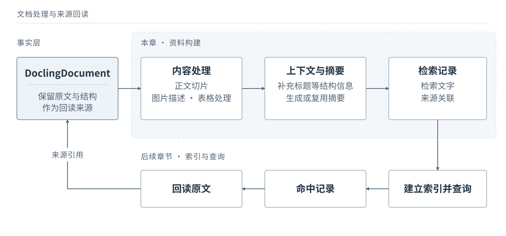

# 004 · Chunk 与增强层：为检索准备资料

上一章：[OCR 与文档解析：一些选择与取舍](003-ocr-and-parsing.md) · [返回总目录](../../README.md#主线教程目录) · 下一章：[从召回到回答：查询流程与 Agentic RAG](005-retrieval-and-agentic-rag.md)

## 已有完整文档，为什么还需要 Chunk

第一章的摩根大通年报有数百页，用户却可能只问：某类衍生品净应付款的公允价值在 2023 年到 2024 年间增加了多少？如果把整篇年报当作一个检索单位，系统找到它以后还需要在不同附注中定位表格。反过来，只留下一个金额，又无法知道它属于什么指标、年份和范围。

传统的关键词检索会利用词语匹配寻找相关内容，向量检索则把文字转换为向量，比较语义上的相关性。两者都需要我们先决定：究竟以多大的一份资料参与检索？本章讨论的 Chunk，就是为这个目的组织的内容块。它可以来自一个原文节点，也可以合并多个节点，或者只覆盖一个长节点的一部分。

在这里，我沿用自己的项目习惯，把完整文档作为事实层，另外构建供检索使用的资料。切片之外，还可以补充标题上下文、图片描述和摘要来实现增强，让用户的提问更容易与检索层资料对应。检索结果最后通过来源引用回读原文，让最终回答以事实层原文为依据，避免将 LLM 生成的摘要直接当作事实。这套流程大致如下：



读完本章，你应该能自己决定一份文档如何切片、哪些内容需要增强、如何增强，以及增强结果如何回到来源。前置知识只需要理解文档节点与 JSON 引用。关于检索技术和配套的数据库结构，我们会放到后面单独介绍。

## 如何利用结构切片

固定长度切片利用的是字符或 token 数，句段切片利用标点和段落边界，结构切片还会利用标题、列表、表格等信息。现在已经有了 DoclingDocument，因此我们从它保留的结构出发，再用长度限制调整大小。

各个框架提供了大量切片方式，这里只聊结构感知切片，以及面对不同的数据时，可能需要做哪些调整。这也是结构感知切片的一个优势，你只需要会这一种就够了。

沿用第一章的财报。在本次整理结果中，物理第 220 页附近的部分节点关系如下，省略了其他节点：

```text
#/texts/3131  流动性风险与信用相关的或有条款
├── #/texts/3132  衍生品与信用风险说明
├── #/texts/3133  应收与应付款的风险说明
├── #/tables/150  净衍生品应付款表
├── #/texts/3134  下一张表的说明
└── #/texts/3135  降级触发条件对流动性的影响
    └── #/tables/151  降级影响表
```

对于正文，我主要复用 Docling 的 HybridChunker。它先使用层级切片结果，再处理超长块，最后在允许时合并相邻的小块。初始块通常对应一个文档元素，不过列表元素等内容可能会被放在一起。

长度调整分两步：能沿文档元素边界拆开的，先在这些边界拆分；单个元素仍然太长时，再进入文本拆分。后者会利用自然文本边界，将一个大段落切散。合并会检查相邻块的标题元数据是否相同，以及合并后的长度是否仍在预算内，同一个层级属于同一个父节点的小块会被考虑合并。

例如，`#/texts/3132` 与 `#/texts/3133` 属于同一章节，满足长度与合并条件时可以作为相邻正文处理；表格则需要保留自己的节点和表头。下面的名称仅用于说明来源关系，不是实验中保存的 Chunk ID：

```text
正文入口（允许合并时） → #/texts/3132、#/texts/3133
应付款表入口           → #/tables/150
降级影响表入口         → #/tables/151
```

结构化切片不主动设置固定 overlap，后续回读时按需扩展邻近内容；金融实验的平面切片另有 overlap 配置。不过，结构感知并不能保证语义完全不被切断，尤其是超长段落继续拆分时。回读能够补充已经命中位置的上下文，却无法补救根本没有被召回的资料。

如果项目中有大量可能需要拆分的长文本块，就有必要考虑自定义部分 HybridChunker 逻辑，设置一定的 overlap，或采用更合适的拆分方式。

此外，Docling 的 `contextualize()` 可以把已有的标题等元数据放在切片正文前。这与 overlap 是不同的操作：前者补充结构信息，后者重复边界附近的内容，二者并不互斥。

## Chunk 多大，以及上下文放在哪里

Chunk 小一些，通常更容易定位到具体内容，但可能把条件和结论分开；大一些，能容纳更多上下文，也可能让无关内容一起参与匹配。我会结合问题长度、答案范围和文档类型选一个起点，再根据实际问题调整。

我的经验起点是：知识库问答约 50–200 token，一般技术文档约 400 token，论文、报告等长文档约 600 token，后两者可以上下浮动约 200。有些财报可能需要 1000 token 甚至更大的切片，具体应结合项目做对照实验。这里的 token 数不是汉字数，需要与所用模型的 tokenizer 对齐。

开始调整时，可以先挑几种不同问题检查切片：比较两个年度的金额、理解风险条款的适用范围，或找到一项指标的计算条件。不同类型的问题，对应的最优切片大小往往是不一样的，我们需要在工程上找到那个妥协的点。

一段话离开章节以后是否仍然读得懂，也值得检查。下面用标题路径和中文概述示意表格切片加入上下文后的内容，并非工具的原样输出：

```text
Notes to consolidated financial statements
Note 5 - Derivative instruments
Liquidity risk and credit-related contingent features
表格正文：净衍生品应付款公允价值及对应年度、单位
```

## 图片：先判断是否需要额外描述

如果暂时采用文本检索，就需要为图片准备可检索的文字。可以先过滤 LOGO 等装饰图片，对有信息价值的图片结合原有图注和视觉模型描述构建检索入口。并不是每张图都要调用模型：如果已有图注足以覆盖查询需要，可以直接复用。

Docling 对图片的默认处理，需要分开看解析和切片两个阶段。以标准 PDF 解析流程为例，被识别为图片的内容会保存为 `PictureItem`，并关联识别到的图注和来源位置，但默认不会调用视觉模型生成图片描述。

到了 HybridChunker 这一步，则是把已有内容序列化为文字。图片关联的 caption 会参与序列化，而图片本身的占位文字被设为空，不会把像素内容直接变成可检索的描述。如果没有图注、已有描述等可序列化的文字，结果为空的图片就不会单独生成文本 Chunk，但事实层中的图片节点仍然保留。

如果需要图中的具体内容，就要额外做图片理解。Docling 提供了可选的[图片描述增强](https://docling-project.github.io/docling/usage/enrichments/#picture-description)，可以通过 `do_picture_description` 启用本地或远程视觉模型。生成的文字保存在图片的描述元数据中，兼容路径也会使用注释字段，再由序列化器纳入切片文字。

这里也要区分库的标准操作和本文的分层策略：Docling 可以把生成的描述附加到文档对象，但在我的方案里，这些描述作为派生资料单独保存在增强后检索层中，并关联回原图片，不替换保留原文的事实层。

## 表格：拆行，还是为整表生成入口

规整的长表可以按行切分，并为每块保留表头。HybridChunker 支持在表格超长拆分时重复表头，但具体行为取决于表格序列化及相关配置。这样读到一行数据时，仍能知道每一列的含义。对于很多工程来说，这个默认逻辑已经足够了。

另一种选择是保留完整表格，生成整表摘要作为检索入口。有些表格需要结合多行、多列理解，哪怕有结构化感知和表头重复，拆开以后也未必好用。

财报物理第 220 页的 `#/tables/150` 中，有下面这两行。金额单位为百万美元，表格限定了相关衍生品的合同范围：

| 指标 | 2024 年末 | 2023 年末 |
| --- | ---: | ---: |
| 净衍生品应付款公允价值 | 15,371 | 14,655 |
| 已提供抵押品 | 15,204 | 14,673 |

```text
整表摘要示意：带降级触发条件的相关衍生品应付款和已提供抵押品，
比较 2024 年末与 2023 年末的金额。
来源引用：#/tables/150
```

查询两个年度之间的变化时，希望先找到这份资料，再读取表格并计算。摘要只承担找到表格的工作，具体值仍以原表为准。如果摘要没有保留某个指标或条件，相关查询仍可能漏掉它；此时可以补充重要术语、保留适合检索的表格文字，或者改用按行组织的方案。

所以整表摘要适合哪些表格，需要看查询需求。若主要需求是大量精确筛选、统计和关联查询，我会考虑数据库，而不是不断把业务数据压进摘要里。这部分后面再聊。

## 为 Chunk 补充面向检索的摘要

图表处理结束后，正文 Chunk 还可以生成一份简短摘要。结构上下文说明属于哪里，图表描述提供原本不便直接检索的文字，Chunk 摘要则概括这部分在讨论什么、适用于什么条件。

增强层的摘要与查询时的重写，可以看作同一个问题的两面：一边整理资料的表达，一边整理问题的表达，帮助用户的提问与文档内容对应，尝试改善召回效果。

> 参考提示：根据给出的 Chunk 和标题上下文，概括它讨论的事项、适用范围与限制条件。保留重要人名、时间、编号和否定条件。只使用提供的内容；不确定的内容保持不确定，不补充背景知识或推测结论。

已有描述的图片和表格不必再总结一次，可以复用之前的结果。我比较过只检索摘要、摘要与内容拼接，以及两者分开索引的方式，采用了拼接，但当时没有观察到明显差别。

只检索摘要，文字更集中，也更依赖摘要的信息覆盖；拼接保留了细节，但增加长度，摘要中的错误也会进入检索文本。两者分开索引，则能分别利用主题概括和原文细节，不过需要处理不同入口命中同一份资料的情况。选择之前，先想清楚用户更常按主题找内容，还是按具体实体与条件找答案，这点和 Chunk 大小一样，需要根据场景作出选择。

## 最后交给检索系统什么

下面将表格整理成一条供检索使用的记录示意。字段和 `table-001` 是本文为说明关系使用的名称，不是 Docling 原生 Schema，也不是实验中实际保存的 Chunk ID。

```json
{
  "chunk_id": "table-001",
  "kind": "table",
  "source": {
    "document_id": "jpmorgan_chase_2024",
    "refs": ["#/tables/150"],
    "page_number": 220
  },
  "headings": ["Note 5 - Derivative instruments", "Liquidity risk and credit-related contingent features"],
  "summary": "相关衍生品应付款与抵押品的年度比较",
  "retrieval_text": "衍生工具附注；净衍生品应付款公允价值；2024 年与 2023 年"
}
```

检索文字可以包含标题、摘要和原文；这里为便于阅读省略了表格正文。实际生成摘要时还应记录模型、提示词或构建版本，便于检查与重建。图片和表格记录沿用相同的来源关联思路。

在 Docling 切片结果中，`meta.doc_items` 保存来源节点对象，我们可以取出其中的 `self_ref` 构建这里的引用列表。一个 Chunk 能关联多个节点；长段落拆成两块时，两条记录也可能指向同一个节点。我们后面会再单独聊一聊，如何建模这种关系，实现在数据库中的高效检索与上下文扩展。

增强资料与检索索引单独保存，与事实层保持分离。修改摘要策略时，需要更新受影响的增强资料及索引；如果只更换嵌入模型，通常重新生成向量与对应索引即可，不必重新生成摘要或解析原文件。

到这里，我们已经有了可供检索的文字、来源关联和必要的处理记录。下一篇先假定搜索能力已经就绪，讨论如何召回、聚合和回读这些资料，并生成最终答案；具体的存储与索引组织留到后面单独展开。

## 参考资料与署名

- Docling：[Chunking](https://docling-project.github.io/docling/concepts/chunking/)，关于切片接口、上下文化与表格切片的说明。在线文档可能随版本更新。
- Docling Core 2.91.0：[HybridChunker](https://github.com/docling-project/docling-core/blob/v2.91.0/docling_core/transforms/chunker/hybrid_chunker.py)、[HierarchicalChunker](https://github.com/docling-project/docling-core/blob/v2.91.0/docling_core/transforms/chunker/hierarchical_chunker.py)与[contextualize 实现](https://github.com/docling-project/docling-core/blob/v2.91.0/docling_core/transforms/chunker/base.py)。本章据该版本源码核对行为。

本章原创正文与结构示意采用 [CC BY 4.0](../../LICENSE-DOCS)；财报内容遵循其来源许可。
