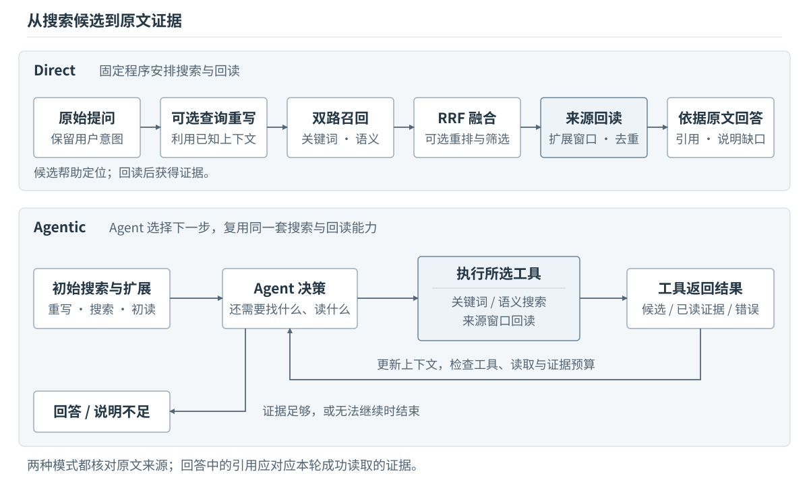

# 005 · 从召回到回答：查询流程与 Agentic RAG

上一章：[Chunk 与增强层：为检索准备资料](004-chunks-and-enrichment.md) · [返回总目录](../../README.md#主线教程目录) · 下一章：[数据库存储与结构化回查](006-databases-and-source-lookup.md)

## 检索层准备好了，一次查询还要做什么

上一章准备了带上下文、摘要和来源关联的检索资料。现在的问题是：用户提出问题后，怎样找到相关资料，并把回答建立在原文上？

继续看摩根大通 2024 年报。假设用户想知道：2023 年到 2024 年，净衍生品应付款的公允价值增加了多少？财报物理第 220 页有对应表格，但表格有适用范围：它讨论的是带降级触发条件的场外及清算场外衍生品。回答需要保留这个范围、两个年度和金额单位。

这里先假定检索层已经建立，讨论如何召回、融合、回读和回答。数据库结构留到下一章。



图中展示一般流程，具体步骤由项目决定。

## 查询重写是增强层摘要的另一面

查询重写（Query Rewrite）把用户的话整理成适合搜索的表达。它可以处理指代、别名和专业术语，但不负责提前回答问题，也不应该补入未知事实。

例如，可以把上述问题整理成下面这样的搜索表达：

```json
{
  "original_query": "2023 年到 2024 年，净衍生品应付款的公允价值增加了多少？",
  "semantic_query": "JPMorgan Chase net derivative payables aggregate fair value 2023 2024",
  "keywords": ["JPMorgan Chase", "net derivative payables", "fair value", "2023", "2024"]
}
```

重写应保留公司、指标和年份。原问题没有明确限定合同中的触发条件，因此不能在搜索前把某个未经确认的范围当作已知事实；找到来源后还要核对表格范围。

无论是否重写，都应保留原问题，供回答时对照。重写失败或明显偏题时，也可以回退到原始问题，并记录回退；是否值得引入重写，需要用实际问题比较召回结果。

## 关键词、向量和 RRF

关键词检索适合匹配公司名、财务术语和年份；向量检索可以补充措辞不同但语义相关的资料。两路原始分数的含义和范围不同，不能直接相加。我通常先用 RRF（Reciprocal Rank Fusion）融合排名：

查询向量要与建立索引时的嵌入模型和输入格式配套。公司、年份等明确条件可以用于过滤，但最终仍要在原文中核对，不能完全交给相似度判断。

```text
RRF(d) = Σ 1 / (k + rankᵢ(d))
```

其中 `rankᵢ(d)` 是资料在第 `i` 路中的名次，`k` 控制名次差距的影响；某一路没有返回该资料时，这一路不贡献分数。

下面是这道问题的一次实际检索结果。取 `k = 20`，前四个候选的两路排名和融合分数如下：

| 融合后 | 关键词名次 | 向量名次 | RRF 分数 |
| --- | ---: | ---: | ---: |
| 候选 1 | 2 | 4 | 0.087121 |
| 候选 2 | 1 | 8 | 0.083333 |
| 候选 3 | 3 | 21 | 0.067869 |
| 候选 4 | 8 | 15 | 0.064286 |

例如，候选 1 的分数是 `1/22 + 1/24`，它关联到摩根大通年报物理第 220 页的资料。候选太少可能提前漏掉资料，太多会增加后续读取量。即使两路都返回内容，也要检查必要资料是否真的进入候选池。

同一条检索记录在两路出现时，可以累加排名贡献并只保留一个候选；不同 Chunk 也可能关联同一个原文节点，回读时还要按来源去重，避免重复内容占满上下文。

## 重排与原文回读

RRF 只利用排名，没有重新判断问题和候选的内容。Rerank 可以进一步判断相关性，但会增加延迟与调用成本，也可能过度偏好写得流畅的摘要。我习惯默认使用 RRF，按需要在融合后、回读前加入重排。我基本不再部署独立的重排模型；需要时会用一次单独的 LLM 请求处理。

重排决定优先读取哪些候选，回读负责取得原文证据；两者都无法找回召回阶段完全漏掉的资料。摘要可以帮助定位内容，回答仍应回到原文核对。例如，读到财报物理第 220 页的表格后，可以找到同一指标的两个年度金额：2024 年为 15,371、2023 年为 14,655，单位均为百万美元，相差 716 百万美元。回答时还需要保留表格中的合同范围，不能把它泛化成所有衍生品应付款。

一条检索记录可能关联多个原文节点；一个长节点也可能对应多个切片。来源定位至少要说明文档、文档版本和节点或页面位置。证据标识只在对应的查询与读取上下文中有效，不应跨查询混用。

检索单位较小时，命中内容未必包含所有条件。先找到小块，再按需扩大读取范围，通常称为 Small to Big。例如命中 `#/tables/150` 后，除了表格本身，还可以读取相邻正文、所属章节或关联的图注，检查合同范围和单位。这些扩展需要分别依据阅读顺序、父子关系和关联引用。具体怎样保存和查询这些关系，下一章会继续展开。

## Direct 和 Agentic 如何分工

Direct 由固定程序安排搜索、融合、读取和回答；Agentic RAG 则让 Agent 根据已读内容决定是否继续搜索、读哪条来源和何时结束。两种方式都可以使用关键词、向量与原文回读，区别在于下一步由谁决定。

再看同一份年报中的另一道问题：公司的三道风险防线如何与高级管理层委员会的职责衔接？相关信息分布在多个页面，单个命中不一定足以回答。

例如，Agent 可以先搜索并阅读有关风险防线的章节；如果还需要了解委员会的职责，再继续搜索并阅读相关内容。年报物理第 95 页和第 97 页有可供核对的资料。一个可能的过程是：

```text
问题重写 → 搜索风险防线 → 阅读相关章节 → 按需搜索委员会职责
         → 阅读相关章节 → 汇总证据并回答
```

Agent 也可以调用封装了混合检索的工具；重点是它根据已有结果决定下一步。

如果初始结果已经覆盖问题，Agent 不必为了多轮而重复搜索；如果证据不足，它可以继续搜索、扩大原文读取范围，或者在无法核实时明确说明缺口。

### 让循环有结束条件

我会分别限制工具轮数、来源读取次数和累计证据 token 数。重复改写查询可能消耗多轮却没有新内容；一次读取长表格，也可能迅速耗尽证据预算。

这些预算由执行工具的程序检查，不能只在提示词里要求 Agent 节制。读取失败要带着错误返回，让它判断是否换一个来源。连续搜索没有新增候选或证据时，也要考虑是否还有继续搜索的必要。

证据足够时可以提前结束；证据不足时应给出有限回答或说明无法回答。结束前检查引用是否来自本轮成功读取的证据，以及证据是否支持对应句子。

## 常见的查询故障与检查

一次回答错误可以发生在不同位置。我更愿意先定位失败的阶段，再决定是否加工具、调参数或换模型：

- 重写是否改变了公司、年份、指标或适用条件？
- 必要资料是否进入至少一路候选，还是两路都没有找到？
- 资料是否在融合、截断或重排后被丢掉？
- 回读是否找到正确版本，窗口是否覆盖表头、单位和条件？
- 回答引用是否来自本轮已读证据，证据是否支持那句话？

例如，第 220 页的表格没有被召回，是候选覆盖问题；表格进入候选后被截掉，是筛选问题；正确读取了两个年度却算错差值，则是读取后的理解或生成问题。

记录原始问题、实际搜索表达、分路候选与排名、保留名单、读取的来源版本及证据、最终引用，同时记录各阶段耗时和调用量。这些信息组成查询过程的 trace，帮助我们区分“没有找到”“找到但没读到”和“读到但答错”。

## 小结

服务规模上升以后，需要在成本和收益之间找到平衡。优化召回、回读和回答的细节，Direct 模式也可以取得不错的效果；Agentic 的多轮查询应结合任务需求和预算选择。

无论采用哪种方式，检索结果都需要指向正确版本的原文，并在需要时读取相邻内容和所属章节。下一章会讨论如何用数据库保存文档版本、节点关系和阅读顺序，支持这些查找与回读。

## 参考资料与署名

- G. V. Cormack、C. L. A. Clarke、Stefan Büttcher：[Reciprocal Rank Fusion outperforms Condorcet and individual Rank Learning Methods](https://cormack.uwaterloo.ca/cormacksigir09-rrf.pdf)，SIGIR 2009。
- [SQLite FTS5](https://www.sqlite.org/fts5.html) 与 [PostgreSQL 全文检索](https://www.postgresql.org/docs/current/textsearch-controls.html)。
- [sqlite-vec](https://alexgarcia.xyz/sqlite-vec/) 与 [pgvector](https://github.com/pgvector/pgvector)。
- Sentence Transformers：[Retrieve & Re-Rank](https://www.sbert.net/examples/sentence_transformer/applications/retrieve_rerank/README.html)。
- [ViDoRe V3 Finance - EN](https://huggingface.co/datasets/vidore/vidore_v3_finance_en)：年报及问题的上游来源。

本章原创正文与 SVG 采用 [CC BY 4.0](../../LICENSE-DOCS)；财报及题目遵循各自来源许可。
